# Rift native UI — screenshot gallery and visual regression

**Status:** current (2026‑10‑19). The offscreen preview set (§1–§8, plus the two
HiDPI captures in §9) was regenerated from the **final workspace binary** —
`target/debug/rift-music.exe`, i.e. the debug profile of the final tree
(workspace with `ui/` and `dist/` removed, `backend` as the default feature) —
via the app's offscreen screenshot mode with `RIFT_PREVIEW` placeholder data: no
webview and no GPU window, and no network. That offscreen set is deterministic
and reproducible on any machine with a working Vulkan driver. Preview and
screenshot support is development-only (debug builds, or an explicit
`--features preview` build): the shipped release binary compiles it out and
rejects the `--preview`/`--screenshot` flags. §10 is a separate,
**non-deterministic** capture of the live window (real backend, real network
cover art); §11–§15 cover headless interaction tests, the visual-regression
procedure, known deltas and the contact sheet.

Two references are in play:

* [`Previews/image.png`](../../Previews/image.png) is now **the native Vulkan home
  render itself** (the repo's front-page screenshot, pixel-identical to
  [`screenshots/01-home.png`](screenshots/01-home.png) — `mean |dc| 0.00`, the
  files differ only in PNG encoding).
* [`reference-old-ui.png`](reference-old-ui.png) is the **legacy webview
  capture** (1160×740, Segoe UI) kept for visual-regression comparison. That is
  the acceptance reference used by the numbers below.

The pixel targets are [`ui-spec.md`](ui-spec.md) and the design source of truth
remains `ui/styles.css` (removed from the tree after the port; the rules are all
captured in the spec).

```powershell
# one view (offscreen, no window, no network):
cargo run -p rift-desktop -- --preview --screenshot artifacts/screens/<view>.png `
    --size 1160x740 --view <home|liked|playlist|search|artist|artist-songs|album|settings>

# HiDPI captures (physical size = logical * scale):
cargo run -p rift-desktop -- --preview --screenshot artifacts/screens/home@1.5.png `
    --size 1160x740 --scale 1.5 --view home

# whole verification loop (fmt, compile, tests, all screenshots, compare):
pwsh tools/verify.ps1
```

The committed copies below live in [`screenshots/`](screenshots/); `artifacts/`
is scratch space (gitignored) that was cleaned up after acceptance — the
commands in this document regenerate it. The committed
[contact sheet](screenshots/12-contact-sheet.png) and
[final gate log](evidence/final-gate.log) preserve the acceptance state.

---

## 1. Home (reference frame)

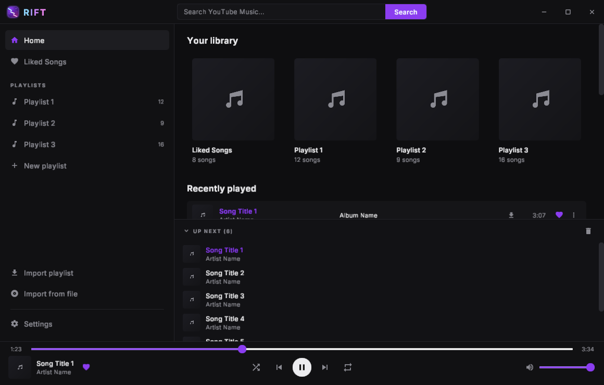

Home is the only screen the old app's reference screenshot shows, so it gets the
tightest comparison. Contents: 46 px titlebar (logo wordmark, centred 480×31
search box with the accent Search button, three 46 px window controls), the
335 px sidebar (preview mode; the interactive default is 216), the
main view with the four "Your library" cards and the hovered first "Recently
played" row, the "UP NEXT (6)" queue panel, and the player bar with the seek row
and transport controls.

**Compared with the legacy webview capture** ([`reference-old-ui.png`](reference-old-ui.png),
`python tools/compare_images.py`, see [§13](#13-visual-regression-procedure)):

| Region | mean abs channel Δ | max Δ | pixels > 16 |
|---|---|---|---|
| titlebar (y 0–46) | 2.02 | 234 | 3.70 % |
| sidebar (x 0–335) | 1.72 | 185 | 3.03 % |
| main (y 46–421) | 2.39 | 223 | 2.56 % |
| queue (y 421–656) | 2.12 | 219 | 2.67 % |
| player (y 656–740) | 2.34 | 221 | 4.33 % |
| **whole frame** | **2.14** | **234** | **2.97 %** |

The residual is font rasterisation (the legacy capture used Segoe UI via the
webview fallback; the native app embeds Inter with the spec's 1.33 line boxes)
plus text antialiasing, not layout: every pixel anchor listed in
`ui-spec.md` §13 matches, e.g. `(0,0)=(17,17,19)`, `(340,22)=(35,35,40)`,
`(500,420)=(21,21,24)`, `(500,422)=(18,18,21)`, `(700,407)=(21,21,24)`,
`(1155,100)=(42,42,48)`, `(580,705)=(236,236,239)`, `(464,670)=(139,61,240)`,
`(1037,705)=(139,61,240)`, `(0,739)=(17,17,19)`.

Side-by-side, amplified diff and 50/50 overlay (regenerated by the compare tool):

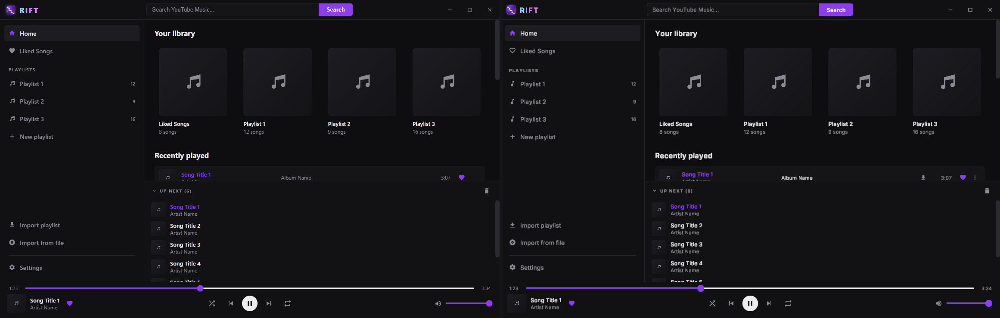

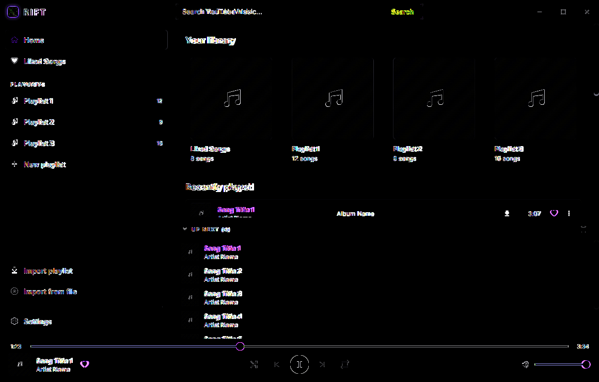

---

## 2. Liked Songs

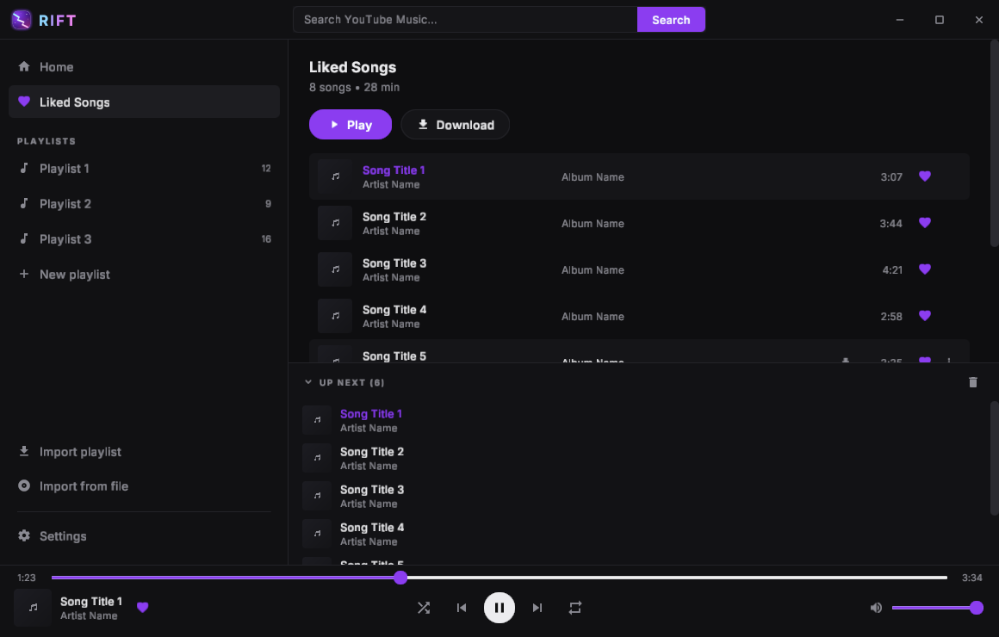

`.view-head` h2 (17/700, line 22), `.collection-meta` "8 songs • 28 min", the
Play pill + Download head-button row (`margin: 18px 0 16px`, 35 px tall), then the
shared 54 px track rows. The first row is the currently playing song, so its
title is accent and the row background is `#151518`; the hovered row also reveals
the kebab.

Measured vs spec: h2 ink y=70..84 (spec 71..87, Δ1 from Inter's ink box); Play row
y=127..162 (spec: 20 padding + 22 line + 4 + 17 meta + 18 margin = 127); first
track row y=178, rows 54 px apart (spec 389/…, Δ0 for the first row).

```powershell
cargo run -p rift-desktop -- --preview --screenshot artifacts/screens/liked.png --size 1160x740 --view liked
```

---

## 3. Playlist

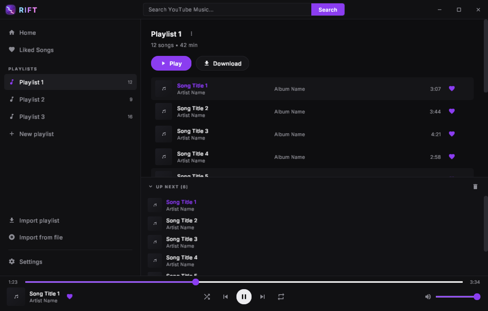

Playlist name as the `.view-head` h2 with its kebab (Rename / Delete) next to it,
`.collection-meta` ("12 songs • 42 min"), Play/Download row, and the track list
whose row menus append "Remove from playlist". The extra 6 px over Liked Songs is
the 28 px kebab button making the view-head 28 px instead of 22 px — the same
flex row height the old CSS produced. Rename mode replaces the h2 with the
`.rename-input` box (17/700, accent border, radius 6, 4×10 padding); Enter
submits, Escape/blur cancels (covered by interaction tests, §14).

Measured: h2 ink y=102..108, Play row y=133..168, first row y=184; `.ibtn` kebab
28×28 centred in the 28 px head.

```powershell
cargo run -p rift-desktop -- --preview --screenshot artifacts/screens/playlist.png --size 1160x740 --view playlist
```

---

## 4. Search — Songs tab

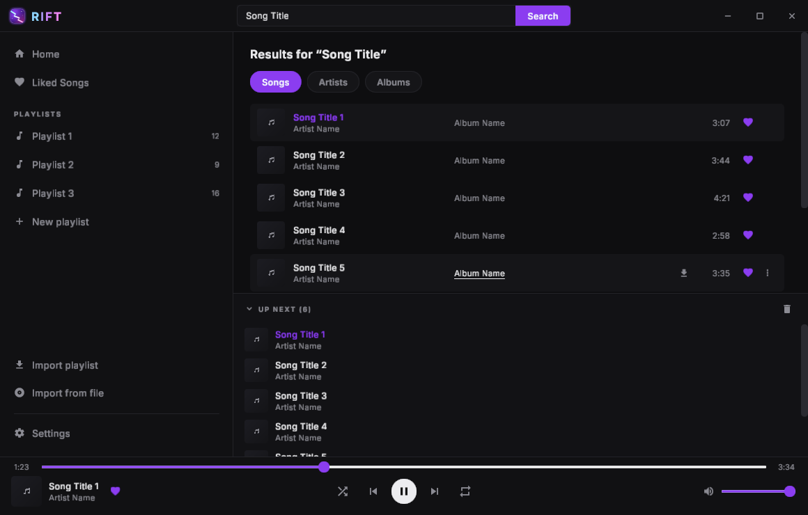

`Results for “Song Title”` (curly quotes as in the old markup) as the first-child
h2, the Songs · Artists · Albums tab pills (`.tab`: 13/600, 6×16 padding, pill
radius, raised background; active = accent fill + white text), then the results
track list. The pointer in screenshot mode sits at (700, 407) to reproduce the
reference hover, which lands on the fifth result row: raised background, centred
album column underlined (it is a link), reveal-on-hover kebab and download icon.

Measured: h2 line y=66..88, tabs y=102..133 (31 px tall, spec `TAB_H`), first row
y=149. Artists/Albums tabs lazy-load into the same 178 px card grid used by the
album/artist pages (round avatars + subscriber counts for artists), covered by
`pages::tests::search_artist_and_album_tabs_paint_grid_covers`.

```powershell
cargo run -p rift-desktop -- --preview --screenshot artifacts/screens/search.png --size 1160x740 --view search
```

---

## 5. Artist page

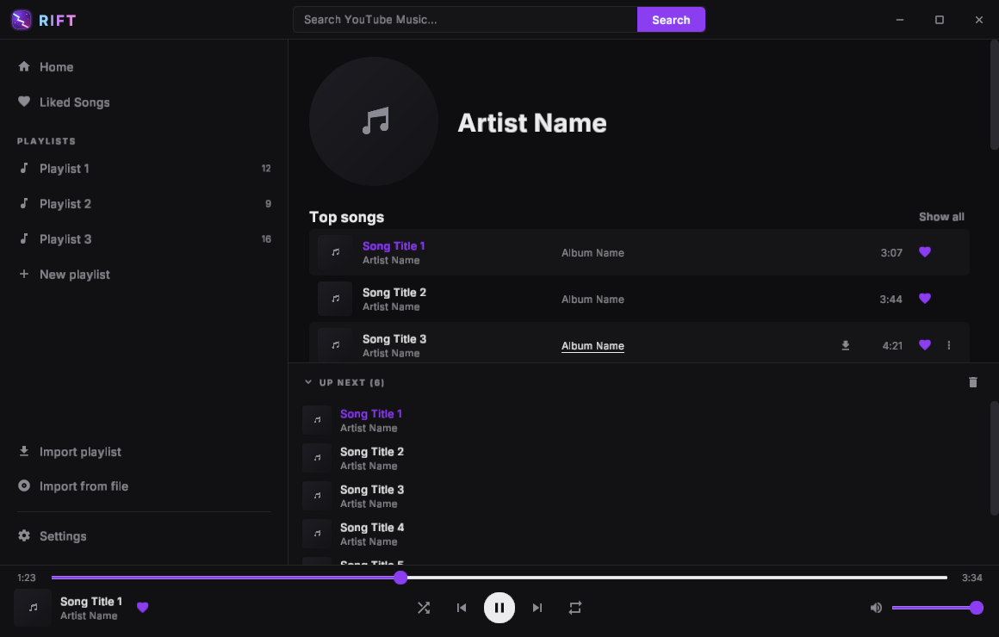

`.page-head` with the 150 px round avatar and the 30/800 page title, vertically
centred (the CSS `align-items: center`), then the "Top songs" h2 with the
right-aligned "Show all" link, the top-track list, and (below the fold at this
window size) the Albums and Singles card grids. The old UI deliberately does not
render `description`/`subscribers` on the artist page.

Measured: avatar box `(359,66)–(508,215)` (150×150, Δ0); meta block starts at
x = 359 + 150 + 22 = 531 (spec gap 22); "Top songs" baseline y≈246; first track
row y=266 (page-head 150 + 24 margin + 22 h2 + 4 view-head == 266).

```powershell
cargo run -p rift-desktop -- --preview --screenshot artifacts/screens/artist.png --size 1160x740 --view artist
```

---

## 6. Artist — All songs

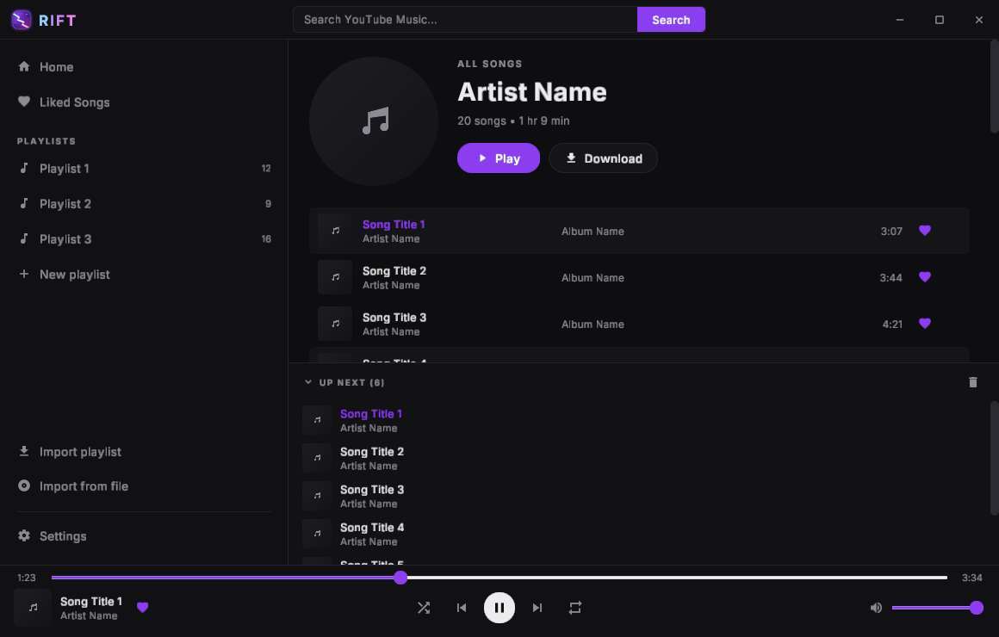

`View::ArtistSongs`: same page head, with the `.page-kind` "ALL SONGS" line
(11/700, 1.5 px tracking), the artist name as a link back to the profile, the
`"20 songs • 1 hr 9 min"` sub line and the Play/Download row (queue source
`artist:<id>`) inside the meta block, then the full catalogue track list. The
meta block (151 px) is taller than the 150 px avatar, so the page head grows by
1 px; measured first row y=241 (= 66 + 151 + 24).

```powershell
cargo run -p rift-desktop -- --preview --screenshot artifacts/screens/artist-songs.png --size 1160x740 --view artist-songs
```

---

## 7. Album

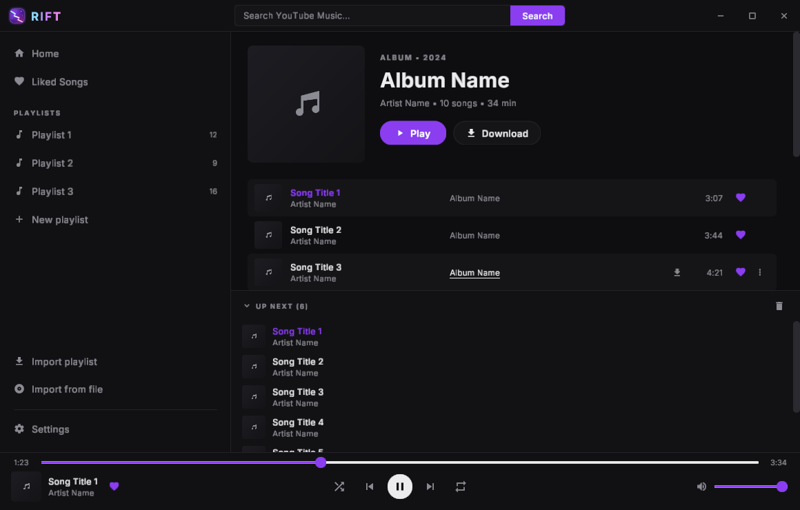

170 px album art (radius 8) beside the meta block: `.page-kind`
`"ALBUM • 2024"` (uppercase), 30/800 title, `.page-sub` with the artist as a link
and `" • 10 songs • 34 min"`, then Play/Download. The track list follows after the
24 px page-head margin.

Measured: art box `(359,66)–(528,235)` (170×170, Δ0); meta centred in the 170 px
head (`(170−151)/2 = 9.5` offset); kind ink y≈85..95, title line y≈104..144, sub
y≈145..162, actions y≈174..209, first track row y=260.

```powershell
cargo run -p rift-desktop -- --preview --screenshot artifacts/screens/album.png --size 1160x740 --view album
```

---

## 8. Settings

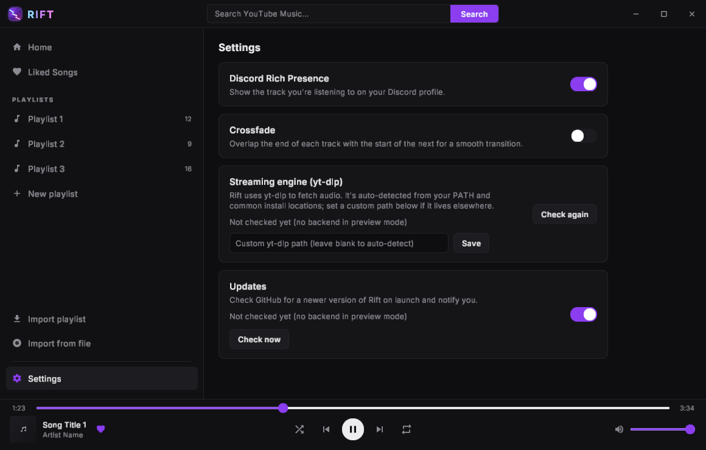

Four `.settings-row` cards (`max-width: 640`, `padding: 16px 18px`, flex
`gap: 20`, raised background, 1 px border, radius 10, 12 px apart): Discord Rich
Presence (switch), Crossfade (switch + 1–12 s slider with the `Ns` value when
on), Streaming engine / yt-dlp (status badge, path `code` chip, "Download
yt-dlp" when missing, custom-path input + Save, right-aligned "Check again") and
Updates (status line, "Check now" + "Download update", notifications switch).
Row heights are derived from the wrapped description text so the view's
scrollbar and the painted rows always agree.

Measured card bands: `103–174` (71 px), `188–259` (71), `273–431` (158),
`445–589` (144). The Discord row is 71 px because `.settings-row` uses
`align-items: center` and the label + one 17 px description line is 41 px of
content inside 32 px of padding (border-box measurement explains the ±1 px vs
the 73 px arithmetic). In preview mode the two probe-backed status lines read
"Not checked yet (no backend in preview mode)" instead of a "Checking…" that
can never resolve; a live launch runs the real probes on mount.

```powershell
cargo run -p rift-desktop -- --preview --screenshot artifacts/screens/settings.png --size 1160x740 --view settings
```

---

## 9. HiDPI captures

The renderer lays out in logical px and multiplies by the window scale factor.
`--scale` exercises the same path offscreen; text/icon atlases are rasterised at
the physical size, so the result is crisp rather than upscaled.

| Scale | Physical size | Capture |
|---|---|---|
| 1.25 | 1450×925 | 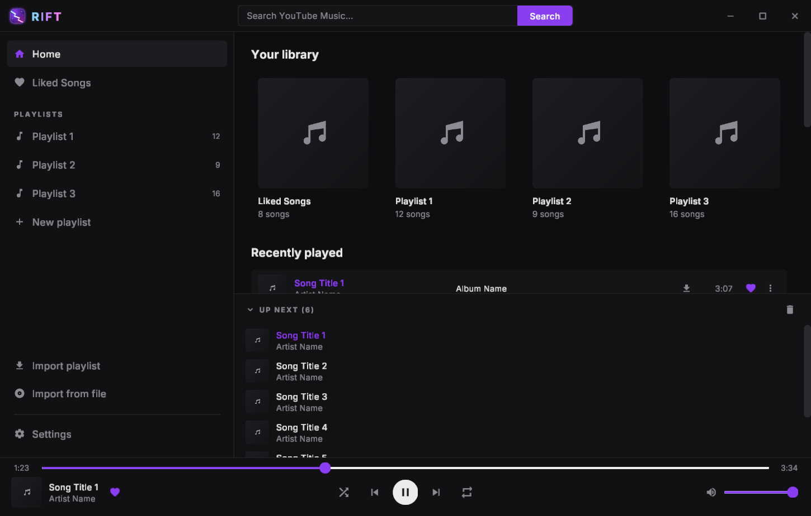 |
| 1.5 | 1740×1110 | 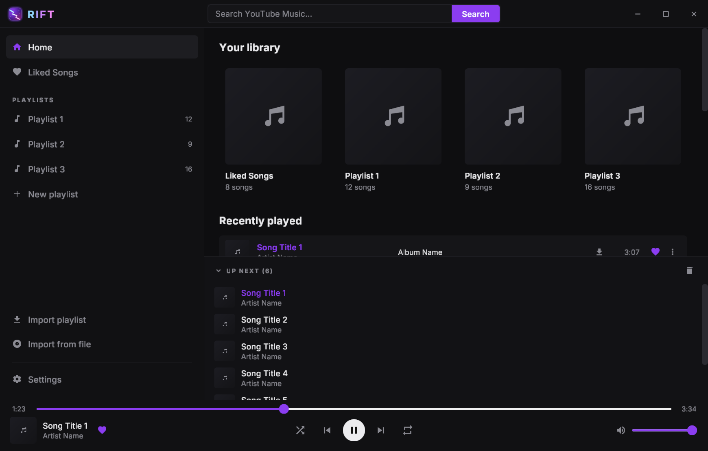 |

```powershell
cargo run -p rift-desktop -- --preview --screenshot artifacts/screens/home@1.25.png --size 1160x740 --scale 1.25 --view home
cargo run -p rift-desktop -- --preview --screenshot artifacts/screens/home@1.5.png  --size 1160x740 --scale 1.5  --view home
```

Bands, paddings and hit rectangles are scale-invariant (all rects are logical
px); only glyph bitmap resolution changes. `tools/compare_images.py` resizes a
HiDPI capture back to 1160×740 before comparing, so it can be diffed against the
reference directly.

---

## 10. Live window with real cover art

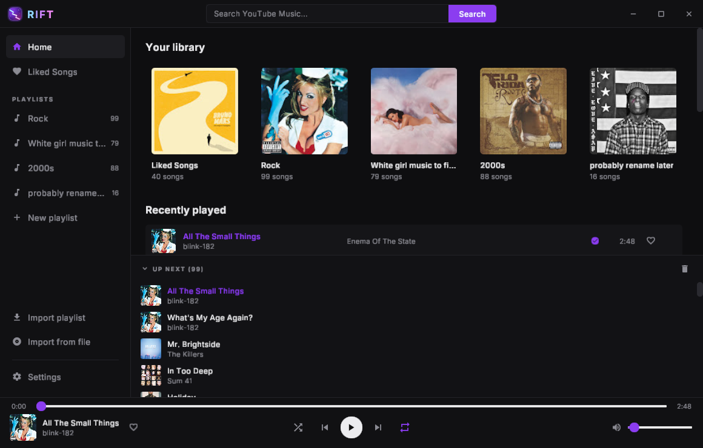

`target/debug/rift-music.exe` with no flags (real backend, windowed swapchain,
real cover-art textures fetched by the controller and uploaded through
`PaintList::created`). This is the end-to-end proof that cover art flows from the
network/decode path into the Vulkan renderer: the titlebar logo texture, the
library covers, the recently-played covers, queue covers and the player-bar cover
are all GPU textures, and text/icon glyphs come from the same atlas mechanism.

---

## 11. Interaction coverage (headless)

The gallery pins pixels; the behaviour is pinned by scripted-input tests that
drive a real `Ui` with synthetic `InputState` sequences (press/move/release,
typed text, keys) — no window, no GPU, `cargo test -p rift-desktop --lib
screens::`. Inventory (all in the screen modules that own the widgets):

| Area | Test | Asserts |
|---|---|---|
| `menu.rs` | `one_item_click_pushes_exactly_one_action` | item click → exactly one Action, menu closes |
| `menu.rs` | `escape_closes_the_menu_without_emitting` | Escape closes, no action |
| `menu.rs` | `outside_press_closes_and_consumes_the_frame` | outside click closes and is swallowed for the frame |
| `track_list.rs` | `kebab_click_opens_the_track_menu` | row kebab opens the track menu, row does not play |
| `track_list.rs` | `heart_click_emits_toggle_like_without_playing` | nested heart control likes without playing the row |
| `track_list.rs` | `each_track_menu_entry_emits_its_action` | every real menu entry (Play next, Add to queue, Download, Go to artist/album, Remove from playlist, submenu option) → its exact Action, one per click |
| `track_list.rs` | `head_play_pill_emits_play_tracks_or_toggle` | Play pill starts `PlayTracks`; current collection toggles |
| `track_list.rs` | `head_download_pill_emits_download_and_remove` | Download → `DownloadTracks`, complete → `RemoveDownloads` |
| `playlist.rs` | `header_kebab_opens_rename_and_delete_menu` | header menu entries → `BeginRenamePlaylist` / `DeletePlaylist` |
| `playlist.rs` | `rename_input_enter_submits_and_escape_cancels` | Enter → `RenamePlaylist` + `ClosePlaylistEditor`; Escape → close only |
| `queue.rs` | `row_click_emits_queue_jump`, `remove_x_emits_queue_remove`, `clear_button_emits_queue_clear`, `header_click_toggles_collapse`, `dragging_row_zero_over_row_two_emits_queue_move` | jump / remove / clear / collapse / drag → `QueueMove{from,to}` |
| `search.rs` | `tab_pills_emit_set_search_tab` | Artists/Albums pills → `SetSearchTab` |
| `settings.rs` | `discord_switch_emits_set_discord_rpc`, `crossfade_slider_emits_set_crossfade`, `check_again_and_check_now_emit_their_actions`, `update_available_offers_a_download_link`, `missing_ytdlp_offers_download` | switches/sliders/buttons → mapped Actions |
| `pages.rs` | render smoke tests | every view (and both lazy search tabs, artist grids) paints a non-empty frame |

These tests are also the reason three real bugs were found and fixed upstream in
this pass (player seek never emitting `Seek`, titlebar drag stealing search
focus, main-view menus self-dismissing) plus the `cards::track_row`
nested-control ordering bug (heart/kebab clicks were eaten by the row and played
the song). Keep the kebab/heart tests as the regression gate for that ordering.

---

## 12. Queue panel (detail)

Visible in every screenshot except Settings: 44 px header (`padding: 8px 16px`;
caret + `UP NEXT (n)` at 10/700 with 1.5 px tracking + right-aligned clear
button), then a 190 px clipped list of 44 px rows (34 px cover, radius 4, title
13/500 accent when current, artist 12 dim, hover background `#1d1d21`,
hover-revealed remove X, click-to-jump, drag-to-reorder with an accent insertion
line). Measured in the reference frame: covers start at y=471 with a 44 px pitch,
scrollbar thumb x=1150..1159, panel top border at y=421.

---

## 13. Visual regression procedure

The loop is intentionally cheap and needs no UI automation: regenerate the
deterministic screenshots, then let the compare tool produce the three
human-eyeball images.

1. **Regenerate** all views (this also builds and runs the tests):

   ```powershell
   pwsh tools/verify.ps1              # fmt, check (both feature sets), tests, all screenshots, home compare
   pwsh tools/verify.ps1 -SkipTests   # screenshots only
   ```

   or one view:

   ```powershell
   cargo run -p rift-desktop -- --preview --screenshot artifacts/screens/home.png `
       --size 1160x740 --view home
   ```

2. **Compare against the old-UI reference** (only Home has one; the legacy
   webview capture is preserved at `docs/vulkan-migration/reference-old-ui.png`):

   ```powershell
   python tools/compare_images.py docs/vulkan-migration/reference-old-ui.png `
       artifacts/screens/home.png --out docs/vulkan-migration/screenshots/compare --label home
   # writes .../compare/home_side_by_side.png, home_diff.png, home_overlay.png
   ```

   `Previews/image.png` is the *current native* home render, so comparing it
   against a fresh capture reports 0.00 (useful only as a screenshot-pipeline
   self-check); the old-UI capture is the reference for regression numbers.
   `--out` redirects the outputs; the committed copies under
   `docs/vulkan-migration/screenshots/compare/` were produced with the command
   above.

   How to read them:
   * **`*_side_by_side.png`** — reference on the left, native on the right, same
     scale. Best for spot-the-layout-difference in one glance (band edges, card
     columns, row pitch).
   * **`*_diff.png`** — per-pixel absolute delta amplified 4×. Structural drift
     shows up as sharp edges (a moved border, wrong padding); the text areas
     light up faintly because of antialiasing/font substitution and are
     expected.
   * **`*_overlay.png`** — 50/50 blend. Misalignments read as "ghosting" on text
     and lines; a clean overlay means geometry matches.

   The tool prints `mean |dc|`, `max |dc|` and `pixels >16`. Treat
   `mean |dc| <= 3.0` and `pixels >16 <= 5 %` as pass; the final binary measures
   **2.14 / 2.97 %**.

3. **Add a new screen to the gallery**: run its `--view`, copy the PNG into
   `docs/vulkan-migration/screenshots/` with the next `NN-` prefix, and add a
   section to this file with the command, what it shows, and the pixels you
   measured against `ui-spec.md` (use a column scan like the spec's appendix for
   band edges; keep the `±1 px` rule).

4. **HiDPI**: regenerate the `--scale 1.25/1.5` captures when text rendering
   changes; compare them after the tool's automatic resize, or inspect the
   physical-size PNG directly for glyph sharpness.

---

## 14. Notes and known deltas

* **Font substitution** — the old-UI capture (`reference-old-ui.png`) rendered
  Segoe UI; the native app embeds Inter (licence-clean). Line boxes follow
  `ui-spec.md` §4.2 (1.33×), so vertical rhythm matches even though glyph shapes
  differ slightly. This is the main residual in the diff.
* **Reference images** — `Previews/image.png` is the native home render (used on
  the repository front page); `docs/vulkan-migration/reference-old-ui.png` is the
  preserved legacy webview capture and is the reference for the regression
  numbers in this document.
* **Sidebar width** — preview/screenshot mode uses 335 px (the reference capture
  was taken after a drag-resize); the interactive default is 216 px, clamped to
  160–420.
* **Search tab captures** — the CLI screenshot driver always opens the Songs
  tab; Artists/Albums rendering is covered by the grid smoke tests and can be
  captured interactively (the screenshots are deterministic only for a given
  `state.view` + tab).
* **Settings probe text** — preview mode has no backend, so the yt-dlp/update
  status lines show "Not checked yet (no backend in preview mode)"; live runs
  show the real probe results.
* The queue collapse state, open menus and hover states are session state; the
  gallery captures the canonical default of each view (plus the reference
  frame's hovered row, injected via the screenshot pointer at 700, 407).

---

## 15. Contact sheet

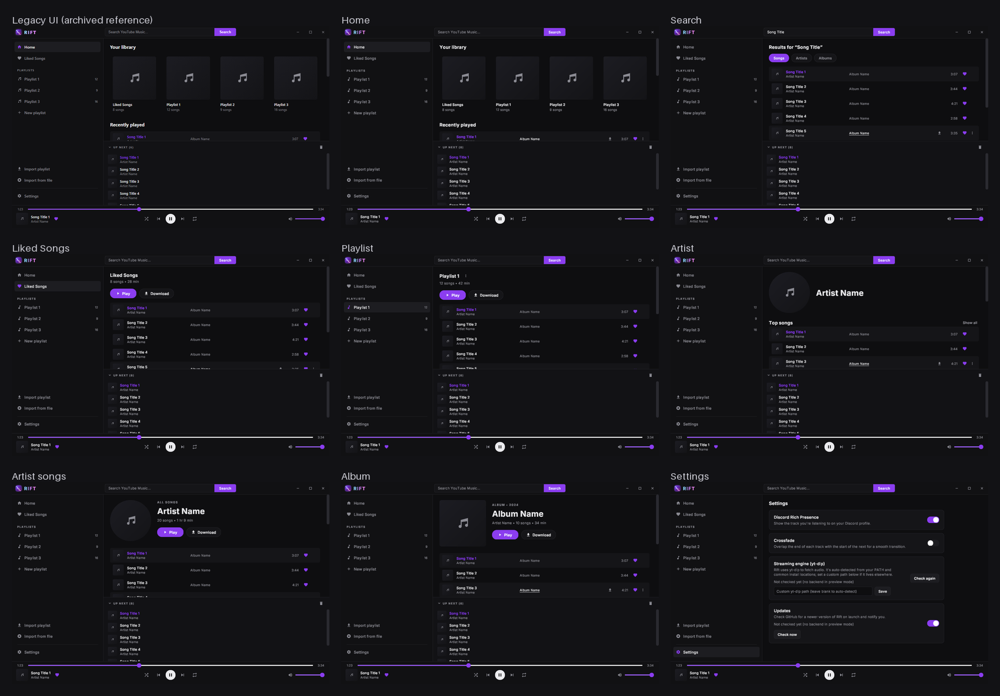

Single-image overview: the archived legacy webview capture (top left, labelled
"Legacy UI (archived reference)") beside all eight native views — home, search,
liked, settings, artist, artist-songs, album, playlist — each rendered from the
final binary at 1160x740 with the deterministic preview data.
